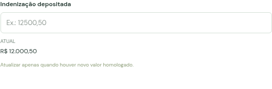
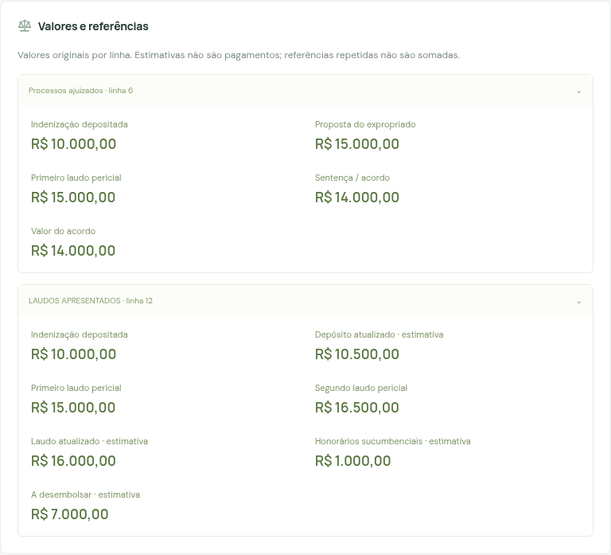

# Manual de testes do Território

**Para quem desenvolve ou testa a plataforma e não atua no jurídico.**

Referência: funcionalidades disponíveis em 30/10/2026. Os exercícios usam dados inteiramente fictícios. Seu objetivo é conferir se o sistema recebe, associa, valida, grava e apresenta as informações corretamente. A equipe fundiária/jurídica confirma o conteúdo dos documentos e a etapa adequada para um caso real.

## Comece pela sua dúvida: “Valores e referências”

**Essa seção é de consulta. Não existe um botão para digitar ou editar valores diretamente nela.**

Em **Processos → abrir um processo → Resumo → Valores e referências**, o site apresenta valores numéricos importados das planilhas anteriores de acompanhamento e perícias, separados por aba e linha de origem. Clique no nome da fonte para expandir os valores.

Na versão com o novo controle, você preenche os valores em **Imóveis e trechos → abrir o imóvel/subtrecho → Cadastro, Perícia ou Acordos**. Os campos atuais aparecem na ficha do imóvel, e a alteração fica no histórico. **Essas edições não reescrevem as referências financeiras históricas da seção antiga.**

| Você quer informar… | Caminho dentro da ficha do imóvel | Campo exato | Exemplo de digitação |
|---|---|---|---|
| Quantia depositada | Cadastro | Indenização depositada | `12000,50` |
| Valor pedido pelo proprietário | Perícia | Proposta do expropriado | `Proposta fictícia de R$ 15.000,00` — campo de texto |
| Avaliação do primeiro laudo | Perícia | Primeiro laudo (R$) | `15000,25` |
| Avaliação do segundo laudo | Perícia | Segundo laudo (R$) | `16500,00` |
| Honorários do perito | Perícia | Honorários periciais / comentários | `R$ 1.800,00 — informação fictícia` — campo de texto |
| Valor negociado em acordo | Acordos | Valor do acordo (R$) | `14000,00` |
| Informação da sentença | Fase final | Sentença | `Decisão fictícia para teste` — campo de texto |

Nos quatro campos monetários — indenização, primeiro laudo, segundo laudo e acordo — use números sem `R$` e sem separador de milhar: `12000,50` ou `12000.50`. Não use `12.000,50`. O sistema apresenta o resultado formatado em reais. Zero é um valor válido; negativo é recusado.

Proposta, honorários e sentença são campos de texto no novo dicionário. Eles podem conter comentários e não entram automaticamente em uma soma. Depósito atualizado, honorários sucumbenciais e outras estimativas das planilhas anteriores continuam como referências importadas, sem formulário próprio de atualização nesta versão.

**O quadro não apareceu?** Isso é esperado em um processo sem fontes financeiras anteriores, inclusive um processo criado pelo botão **Novo processo** ou apenas pelo novo `BANCO_REG`. Consulte os valores na ficha do imóvel. O exercício **T16** mostra como testar especificamente o quadro antigo com fontes fictícias.

## Como usar este manual

1. Prepare o material e a base separada na seção seguinte.
2. Faça **T01 a T04** para entender cadastro e valores.
3. Continue com os documentos, tarefas, mapa e persistência.
4. Faça os testes de revisão e de rejeição de dados.
5. Use **T16** se quiser conferir o quadro “Valores e referências”. Ele utiliza outra base.

O [mapa completo dos 56 campos](MAPA-DE-CAMPOS.md) funciona como índice: procure o nome de um campo para saber em qual área ele está e se aceita edição.

## Preparar uma base fictícia no Windows

Na pasta atualizada do projeto, a mesma que contém `app.py`:

1. Se ainda não configurou esta cópia do projeto, execute **`configurar.bat`**.
2. Execute **`gerar_material_teste.bat`**. Será criada a pasta `material-teste`.
3. Execute **`iniciar_testes.bat`**. Ele abre o navegador na porta **3010** e utiliza a pasta **`data-teste-manual`**.
4. Confira a mensagem **Dados locais** no terminal: o caminho deve terminar em `data-teste-manual`.
5. Mantenha esse terminal aberto durante os exercícios. Para encerrar, pressione **Ctrl+C**.

O iniciador de testes aponta explicitamente para outra pasta; sua base habitual em `data/` permanece separada. Não copie os dados reais para essa pasta de testes. Para voltar à base habitual, use `iniciar.bat`.

Se já existir uma pasta `material-teste` com arquivos, o gerador não a substitui. Você pode reutilizar o material existente. Se a base de testes já tiver sido usada, as contagens iniciais podem ser diferentes: para recomeçar, pare o servidor de testes, renomeie `data-teste-manual` para `data-teste-manual-anterior` e execute `iniciar_testes.bat` novamente. Preserve sua pasta `data/`.

Alternativa pelo PowerShell, sem ativar o ambiente virtual:

```powershell
.\.venv\Scripts\python.exe scripts\gerar_material_teste.py
.\.venv\Scripts\python.exe app.py --data-dir data-teste-manual --port 3010 --open
```

Se a porta 3010 estiver ocupada, use `--port 3012` e siga o endereço impresso pelo terminal. Continue usando o mesmo `--data-dir`. Em Linux/macOS, substitua `.\.venv\Scripts\python.exe` por `.venv/bin/python` e use `/` nos caminhos, por exemplo, `scripts/gerar_material_teste.py`.

### Arquivos que você receberá

| Arquivo em `material-teste` | Para que serve |
|---|---|
| `01_CONTROLE_TESTE.xlsx` | Base inicial: Trecho 1 e Trecho 2, no mesmo processo fictício |
| `02_REVISAO_TESTE.xlsx` | Atualiza apenas providência e responsável do Trecho 1 |
| `03_PENDENCIAS_TESTE.xlsx` | Mostra duplicidade, identificação insuficiente e previsão sem data exata |
| `04_ACOMPANHAMENTO_TESTE.xlsx` | Fonte antiga fictícia para o exercício T16 |
| `05_PERICIAS_TESTE.xlsx` | Segunda fonte antiga fictícia para o exercício T16 |
| `documento_teste_v1.txt` e `documento_teste_v2.txt` | Testam anexos, downloads e versões |
| `area_teste.geojson` | Polígono demonstrativo, sem correspondência validada com um imóvel real |
| `roteiro_resultados.csv` | Planilha para anotar o resultado dos 16 exercícios |

Os exemplos são identificados como **TESTE**. O número judicial utilizado é ilustrativo, sem correspondência verificada com processo real. A plataforma reconhece seu formato para testar o agrupamento; isso não confirma a validade jurídica de um número.

## Entender as telas e os termos

| Termo ou tela | Significado prático para o teste |
|---|---|
| Processo | Dossiê que reúne histórico geral, documentos, tarefas e áreas no mapa. Pode conter vários imóveis/subtrechos |
| Imóvel / subtrecho | Registro detalhado de uma área. Possui chave, valores e acompanhamento próprios |
| Chave do imóvel | Identificador do registro. Dois trechos com o mesmo número de processo precisam de chaves distintas |
| Proprietário / expropriado | Parte relacionada ao imóvel; na proposta, indica de quem vem o valor pedido |
| Laudo pericial | Documento de avaliação técnica. Seu valor é diferente de depósito ou pagamento |
| Honorários periciais | Remuneração do perito, distinta da indenização do imóvel |
| Acordo | Informação da negociação entre as partes. Valor, assinatura e andamento são campos separados |
| Matrícula | Identificação do imóvel no registro imobiliário. Não é o número do processo |
| Imissão de posse | Tema relacionado à entrada na posse/uso da área conforme o instrumento aplicável. O sistema registra andamento e data de cumprimento |
| DUP | Declaração de Utilidade Pública: referência documental do procedimento |
| Registro definitivo | Informação da formalização no registro imobiliário, a conferir com o documento correspondente |
| MVGA | Identificação da equipe/escritório usada nas planilhas para acompanhamento; no teste, funciona como um conjunto de campos de responsabilidade e providências |
| GIS | Referência ao sistema geográfico. Digitar um ID GIS não desenha automaticamente um lote |
| Dados de origem | Cópia dos valores lidos da planilha. Serve para comparar com a fonte, sem edição direta |

**Atenção ao botão Novo processo:** ele cria o dossiê básico. Nesta versão, os registros detalhados em **Imóveis e trechos** são criados pela importação de `BANCO_REG`. Criar apenas um processo não cria automaticamente os 56 campos de um imóvel.

### Como preencher os formulários do imóvel

O campo de entrada pode estar vazio e, abaixo dele, existir um valor identificado como **Atual**. Isso é intencional: o campo vazio significa “não alterar”. Nos seletores, a opção **Manter valor atual** tem o mesmo efeito.

Para salvar uma alteração, preencha **Registrado por** e **Motivo / referência documental**, além dos campos que deseja mudar. Use, por exemplo, `QA — teste manual` e `Exercício fictício T02`.

O botão salva somente a área aberta, como **Salvar Cadastro** ou **Salvar Perícia**. Salve antes de mudar para outra área; não há salvamento automático. Cada salvamento efetivo gera uma nova versão e um evento com antes/depois.

## T01 — Importar os dois trechos

**Objetivo:** verificar criação e vínculo dos registros.

1. Abra **Base de dados → Importar controle**.
2. Selecione `material-teste/01_CONTROLE_TESTE.xlsx` e clique em **Analisar planilha**.
3. Em uma base nova, confira: **2 novos**, **0 atualizações**, **0 sem alterações**, **0 para conferência**.
4. Expanda uma linha para conferir imóvel, subtrecho e dados lidos.
5. Informe `QA — teste manual` em **Responsável pela importação** e confirme.
6. Abra **Imóveis e trechos**. Encontre **TESTE - EEE Jardim Modelo**, com **Trecho 1** e **Trecho 2**.
7. Abra um deles e clique em **Abrir processo**.

**Resultado esperado:** dois imóveis/subtrechos dentro de um único processo. A importação aparece em Base de dados. A ficha pode mostrar observações sobre campos ainda não informados; observações não são o mesmo que linhas bloqueadas.

## T02 — Digitar a indenização depositada

**Objetivo:** testar um valor monetário e o isolamento entre trechos.

1. Abra **Imóveis e trechos → TESTE - EEE Jardim Modelo / Trecho 1 → Cadastro**.
2. Localize **Indenização depositada**. O valor **Atual** inicial é **R$ 10.000,00**.
3. No campo de alteração, digite **`12000,50`**.
4. Preencha autor e motivo e clique em **Salvar Cadastro**.
5. Confira o novo valor em **Atual** e abra **Histórico deste imóvel**.
6. Expanda o evento para ver o campo alterado, o valor anterior e o novo.
7. Abra o **Trecho 2** e consulte o mesmo campo.

**Resultado esperado:** Trecho 1 apresenta **R$ 12.000,50** e histórico da alteração; Trecho 2 continua com **R$ 5.000,00**. Recarregar a página mantém os valores. Eles ficam na ficha do imóvel; o quadro histórico “Valores e referências” não é reescrito.



## T03 — Preencher a perícia

Abra o **Trecho 1 → Perícia** e preencha:

| Campo | Valor de teste |
|---|---|
| Proposta do expropriado | `Proposta fictícia de R$ 15.000,00` |
| Laudo apresentado | `SIM` |
| Segunda perícia | `SIM` |
| Primeiro laudo (R$) | `15000,25` |
| Segundo laudo (R$) | `16500,00` |
| Fase pericial atual | `LAUDO APRESENTADO` |
| Perito nomeado | `Perito fictício de teste` |
| Honorários periciais / comentários | `R$ 1.800,00 — informação fictícia` |

Preencha autor e motivo e clique em **Salvar Perícia**.

**Resultado esperado:** os dois valores de laudo permanecem separados; o segundo não apaga o primeiro. Proposta e honorários ficam como texto. O Trecho 2 mantém sua fase inicial. No resumo do processo, pode aparecer **Fases variam por imóvel**, porque os dois trechos agora têm fases diferentes.

Informar um valor de laudo não anexa seu documento. Selecionar **LAUDO APRESENTADO** não preenche automaticamente **Laudo apresentado = SIM** nem a etapa geral do Cadastro. São campos independentes nesta versão.

## T04 — Preencher um acordo

Abra o **Trecho 1 → Acordos**:

1. Em **Valor do acordo (R$)**, informe `14000,00`.
2. Selecione **15/10/2026** em **Data da assinatura do acordo**.
3. Escolha **ACORDO TOTAL ASSINADO** em **Andamento do acordo**.
4. Preencha autor e motivo; clique em **Salvar Acordos**.

**Resultado esperado:** valor **R$ 14.000,00**, data e andamento persistidos. O depósito e os laudos já informados continuam com seus próprios valores. Não há soma automática entre depósito, laudos e acordo: eles representam informações diferentes, possivelmente sobre a mesma obrigação.

Para testar a etapa geral separadamente, abra **Cadastro**, escolha **TRATATIVAS DE ACORDO** em **Etapa atual**, informe autor/motivo e salve. A escolha é fictícia para exercitar a tela; não define a etapa adequada a um acordo real.

## T05 — Conferir posse, datas e cálculos

1. Abra o **Trecho 1 → Posse e obras**.
2. Confira **Solicitação de ajuizamento** em 01/10/2026 e **Data da petição inicial** em 06/10/2026.
3. Confira **Dias para ajuizar = 5**. Esse campo é calculado e não aceita digitação.
4. Informe **10/10/2026** em **Cumprimento do mandado**.
5. Preencha autor/motivo e clique em **Salvar Posse e obras**.

**Resultado esperado:** o indicador calculado passa para **LIBERADO PARA OBRA**, com a explicação de que usa a data do mandado. Pode surgir uma observação de divergência com o valor da planilha original, que era **AGUARDANDO LIBERAÇÃO**; isso preserva a comparação com a fonte.

Este exercício testa o cálculo implementado. A confirmação de liberação real depende dos documentos e da área responsável. Informar uma data não produz decisão judicial, assinatura ou documento.

## T06 — Registro, acompanhamento e demais campos

Execute no **Trecho 1**, salvando cada área separadamente, sempre com autor e motivo:

| Área | Campo | Exemplo fictício |
|---|---|---|
| Registro | Área registrada (m²) | `180,50` |
| Registro | Matrícula do registro | `MAT-REG-TESTE-001` |
| Registro | Registro definitivo | `Registro fictício conferido no exercício T06` |
| Acompanhamento MVGA | Matrícula conferida | `SIM` |
| Acompanhamento MVGA | Previsão de liberação MVGA | Selecionar 20/11/2026 no calendário |
| GIS | Status GIS | `SIM` |
| GIS | Identificador GIS | `GIS-TESTE-001` |
| Fase final | Sentença | `Decisão fictícia para testar o campo de texto` |

**Resultado esperado:** os campos reaparecem em **Atual**, e os salvamentos ficam no histórico. Após preencher o identificador GIS, ele fica protegido contra substituição. O ID GIS não cria um polígono. A área registrada digitada não altera a área calculada no mapa.

Nesta sequência, deixe **Providência / situação** e **Responsável MVGA** com os valores iniciais: eles serão utilizados na revisão T12. Não é necessário preencher todos os 56 campos para testar um deles.

## T07 — Registrar andamento no processo

1. Na ficha do imóvel, clique em **Abrir processo**.
2. Clique em **Registrar andamento**.
3. Escolha **Decisão / parecer**.
4. Informe autor, título `Parecer fictício recebido` e descrição `Registro de teste; conferir associação ao processo.`
5. Clique em **Salvar andamento**.

**Resultado esperado:** o registro aparece no **Histórico** do processo com autor e data atual. Ele não altera automaticamente etapa, valores ou documentos.

O histórico do processo reúne os eventos gerais e os dos imóveis associados. O **Histórico deste imóvel**, na ficha individual, filtra os eventos específicos daquele registro.

## T08 — Anexar documentos e criar uma nova versão

1. No processo, abra **Documentos → Anexar documento**.
2. Escolha `documento_teste_v1.txt` e a categoria **Laudo pericial**.
3. Mantenha **Documento do processo** no vínculo da área e envie.
4. Clique em **Baixar arquivo** e confira o texto “Versão 1”.
5. Abra novamente **Anexar documento** e escolha `documento_teste_v2.txt`.
6. No campo **Versionamento**, selecione **Nova versão de documento_teste_v1.txt (v1)**.
7. Envie e baixe a nova versão.

**Resultado esperado:** o documento anterior continua disponível e a nova versão mostra “Versão 2”. A categoria organiza o arquivo; um TXT categorizado como laudo continua sendo um TXT fictício. O envio não preenche automaticamente o valor de um laudo.

Depois de criar uma área no T10, você também poderá vincular um novo documento a ela. Não há edição do vínculo de um anexo existente nesta interface.

## T09 — Criar e concluir uma tarefa

1. No processo, abra **Resumo → Criar tarefa**.
2. Digite `Conferir documentação fictícia`, responsável `Equipe de teste` e prazo **31/12/2026**.
3. Clique em **Criar tarefa**.
4. Clique no controle circular ao lado da tarefa para concluí-la.
5. Clique novamente para reabri-la.
6. Confira também **Tarefas e prazos** no menu.

**Resultado esperado:** a tarefa pertence ao processo correto e mantém responsável e prazo. Concluir/reabrir muda seu estado e gera histórico. Esta versão não envia lembretes por e-mail automaticamente.

## T10 — Vetorizar e vincular uma área

1. Abra o processo → **Mapa e áreas**.
2. Clique em **GeoJSON** e selecione `area_teste.geojson`.
3. No formulário que aparece, informe **Nome da área = TESTE - Área Trecho 1**.
4. Escolha **Tipo = Área de interesse**.
5. Em **Referência da planilha**, selecione **Trecho 1 · BANCO_REG L4**. Assim você relaciona a geometria à fonte do trecho certo.
6. Clique em **Salvar área** e recarregue a página.
7. Use o ícone de lápis da área para editar. Altere o nome para `TESTE - Área Trecho 1 revisada` e salve.
8. Use a seta de download para exportar o GeoJSON.

**Resultado esperado:** a área permanece no mapa após recarga, apresenta área positiva estimada e passa de **v1** para **v2** depois da edição. O arquivo exportado contém a geometria. Não há atualização automática das metragens digitadas em Cadastro/Registro.

Para testar o desenho manual, clique em **Desenhar área**, marque pelo menos três vértices e clique no primeiro para fechar. Dê outro nome e salve como **Limite do imóvel**. Evite cruzar as linhas.

O mapa de ruas é opcional e depende de acesso externo. A camada municipal e o GeoJSON de teste podem funcionar mesmo quando **Carregar ruas** falha. O polígono de demonstração não delimita um imóvel real validado.

## T11 — Conferir persistência após fechar

1. Anote os valores e versões atuais.
2. Encerre o servidor de testes com **Ctrl+C** e feche a aba do navegador.
3. Execute novamente **`iniciar_testes.bat`**.
4. Confira depósito, laudos, acordo, documentos, tarefa e área no mapa.

**Resultado esperado:** os registros continuam disponíveis. Se abriu uma base vazia, confira o caminho **Dados locais** e se utilizou o iniciador de testes; outra pasta de dados significa outra base.

## T12 — Importar uma revisão sem perder o que você digitou

1. Abra **Base de dados → Importar controle** e selecione `02_REVISAO_TESTE.xlsx`.
2. Confira **1 atualização**, **1 sem alterações**, **0 novos** e **0 bloqueados**.
3. Expanda a atualização: somente **Providência / situação** e **Responsável MVGA** devem mudar no Trecho 1.
4. Informe o responsável e confirme.
5. Abra o Trecho 1 → **Acompanhamento MVGA** e confira os novos textos.
6. Confira que depósito, laudos, acordo, anexos e geometria continuam como estavam.
7. Reenvie `01_CONTROLE_TESTE.xlsx` apenas para ver a prévia.

**Resultado esperado:** a revisão preserva os campos que vieram vazios. O Trecho 2 permanece igual. Há histórico antes/depois e um registro do backup em Base de dados. Ao reenviar o arquivo inicial já importado, o site informa que não o reaplicará e não oferece confirmação de gravação.

## T13 — Entender as linhas que precisam de conferência

1. Selecione `03_PENDENCIAS_TESTE.xlsx` em **Importar controle**.
2. Confira **1 novo**, **3 bloqueados** e nenhuma atualização.
3. Filtre **Para conferência** e expanda as linhas: duas têm chave repetida e uma está sem denominação suficiente.
4. Volte a **Todos os resultados** e confira a linha nova: a previsão `OUT/2026` é preservada como texto com observação.
5. **Neste exercício, não confirme.** Use **Selecionar outra planilha** ou volte ao menu.

**Resultado esperado:** analisar o arquivo não altera sua base. A linha com data aproximada pode ser elegível com observação; já duplicidade e falta de identificação bloqueiam as linhas correspondentes. A confirmação, quando utilizada, aplica todas as linhas elegíveis, independentemente do filtro visível.

## T14 — Testar regras de preenchimento

Faça estes testes na base fictícia, reabrindo a ficha entre tentativas:

| Ação | Resultado esperado |
|---|---|
| Deixar depósito em branco e alterar apenas um campo de texto do Cadastro | O depósito permanece igual |
| Enviar todos os campos sem alteração | Mensagem **Nenhuma alteração preenchida**; nada é apagado |
| Informar `12.000,50` no depósito, com autor e motivo | Valor recusado; use `12000,50` |
| Informar `-100` em um campo monetário | Valor recusado |
| Observar Chave, Item de origem, Dias para ajuizar e Indicador pela data do mandado | Não há entrada para edição manual |
| Observar Município, Denominação, Subtrecho, Tipo de processo ou datas iniciais já preenchidos e protegidos | Não é oferecida substituição pelo formulário |
| Tentar gravar sem autor ou motivo | O formulário exige preenchimento |

Uma rejeição prevista é um teste aprovado da validação. Não tente contorná-la editando o banco. A tela de erro pode exigir que você reabra a ficha e preencha novamente a alteração.

## T15 — Testar duas abas abertas

1. Abra a mesma ficha do Trecho 1 em duas abas do navegador, ambas em **Acompanhamento MVGA**.
2. Na aba A, altere **Responsável MVGA** para `Equipe A fictícia` e salve com autor/motivo.
3. Sem recarregar a aba B, tente salvar `Equipe B fictícia` no mesmo campo.
4. Reabra a ficha.

**Resultado esperado:** a aba B recebe aviso de registro alterado e não substitui a gravação A. Após recarregar, o valor atual é `Equipe A fictícia`.

A prévia de importação tem uma proteção semelhante: se a base mudar enquanto a prévia estiver aberta, gere outra prévia antes de confirmar.

## T16 — Testar especificamente “Valores e referências”

Este exercício utiliza **outra base**, pois o quadro é alimentado pelo importador das duas planilhas anteriores. Não gere o seed dentro da sua base principal nem na base utilizada em T01–T15.

No PowerShell, a partir da pasta do projeto, execute:

```powershell
.\.venv\Scripts\python.exe scripts\import_workbooks.py ".\material-teste\04_ACOMPANHAMENTO_TESTE.xlsx" ".\material-teste\05_PERICIAS_TESTE.xlsx" --output .\data-teste-referencias\seed.json
```

Quando o comando terminar sem erro, inicie:

```powershell
.\.venv\Scripts\python.exe app.py --data-dir data-teste-referencias --port 3011 --open
```

1. Abra **Processos → TESTE - EEE Jardim Modelo → Resumo**.
2. Localize **Valores e referências**.
3. Expanda **Processos ajuizados · linha 6** e **LAUDOS APRESENTADOS · linha 12**.
4. Compare os valores abaixo com as planilhas fictícias.

| Fonte | O que conferir |
|---|---|
| Processos ajuizados · linha 6 | Depósito R$ 10.000,00; proposta R$ 15.000,00; laudo R$ 15.000,00; sentença/acordo R$ 14.000,00; acordo R$ 14.000,00 |
| LAUDOS APRESENTADOS · linha 12 | Depósito R$ 10.000,00; depósito atualizado R$ 10.500,00; primeiro laudo R$ 15.000,00; segundo laudo R$ 16.500,00; laudo atualizado R$ 16.000,00; honorários sucumbenciais R$ 1.000,00; a desembolsar R$ 7.000,00 |

**Resultado esperado:** um processo com duas fontes financeiras, ambas consultáveis. Não há edição direta e não há soma automática. Ver o mesmo depósito em duas fontes não significa que houve dois depósitos. Os valores “atualizados” são exemplos importados; o sistema não calculou correção monetária ou juros.



As células monetárias dessas planilhas devem conter números do Excel, não texto como `R$ 10.000,00`. Texto monetário pode permanecer em **Dados de origem** sem entrar nesse quadro. Cabeçalhos e posições das colunas precisam seguir o layout reconhecido pelo importador.

Alterar a planilha ou gerar outro `seed.json` não atualiza automaticamente uma base já importada. Para repetir este exercício do zero, pare seu servidor, preserve/renomeie `data-teste-referencias`, gere novamente o seed no novo diretório e reinicie. Não use esse procedimento para atualizar dados reais.

## Como registrar o resultado e relatar um problema

Abra `material-teste/roteiro_resultados.csv` no Excel. Preencha **Resultado observado**, **Status** e **Observações**. Sugestões de status: **Aprovado**, **Falhou**, **Bloqueado** e **Não executado**.

Para relatar uma falha, envie:

```text
Teste: T02 — Indenização depositada
Versão/pasta do projeto utilizada:
Base usada: data-teste-manual
Tela: Imóveis e trechos > TESTE - EEE Jardim Modelo > Trecho 1 > Cadastro
Passos realizados:
Valor digitado:
Resultado esperado:
Resultado observado:
Mensagem exata exibida:
O erro se repete após recarregar?
```

Capturas da base fictícia ajudam a mostrar o problema. Erros do programa, divergências entre fontes e campos que precisam de confirmação jurídica devem ser registrados separadamente, porque têm causas e responsáveis diferentes.

## Dúvidas frequentes

| Situação | Explicação ou próximo passo |
|---|---|
| Não encontro Imóveis e trechos | Confira se baixou a versão que inclui o novo controle e reinicie o servidor dessa pasta |
| A lista de imóveis está vazia, mas há processos | Importe BANCO_REG; processos antigos/manuais não criam automaticamente esses registros detalhados |
| O campo está vazio, mas há valor em Atual | O vazio é a entrada para uma eventual alteração, não a ausência do valor salvo |
| O valor mudou na ficha, mas não no quadro antigo | O quadro antigo conserva os valores das fontes anteriores; isso é esperado |
| Alterei o laudo e a etapa não mudou | Campos e etapa são independentes; atualize a etapa explicitamente quando apropriado |
| Mudei o acordo, mas o arquivo do acordo não apareceu | Valores não criam anexos; envie o documento em Documentos |
| Há observação em campo que ainda não se aplica | O dicionário marca obrigatoriedades que podem depender da fase; a observação pede conferência |
| O processo tem vários trechos com fases diferentes | Abra a ficha específica; evite interpretar a situação de um trecho como a de todos |
| Registro anterior não foi atualizado por outra chave | Chaves diferentes representam registros distintos; a aplicação não reconcilia identidades automaticamente |
| Não há botão para excluir um processo/registro | A interface atual não oferece essa operação. Para reiniciar testes, preserve/renomeie a pasta fictícia com o servidor parado |
| O Excel não recebeu a alteração feita no site | A atualização é salva na base local. Não há sincronização automática de volta ao XLSX |
| O mapa de ruas falhou | Teste o GeoJSON e a camada local. Ruas dependem de acesso externo |

O resultado esperado deste roteiro é conseguir localizar cada dado, saber onde ele é editado e verificar que uma alteração atinge somente o registro escolhido. Decisões e valores de um caso real devem continuar ligados aos documentos que os fundamentam.
